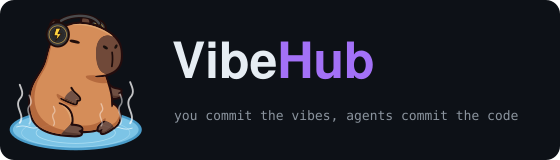
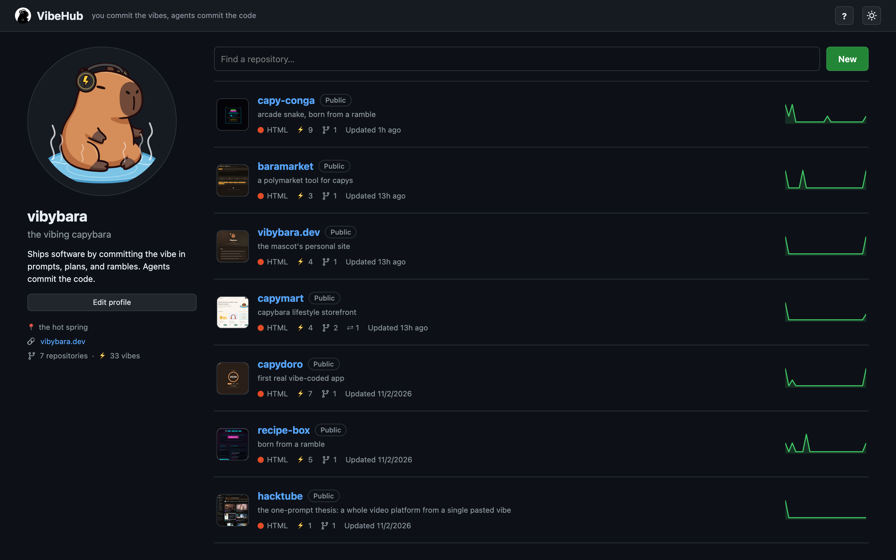
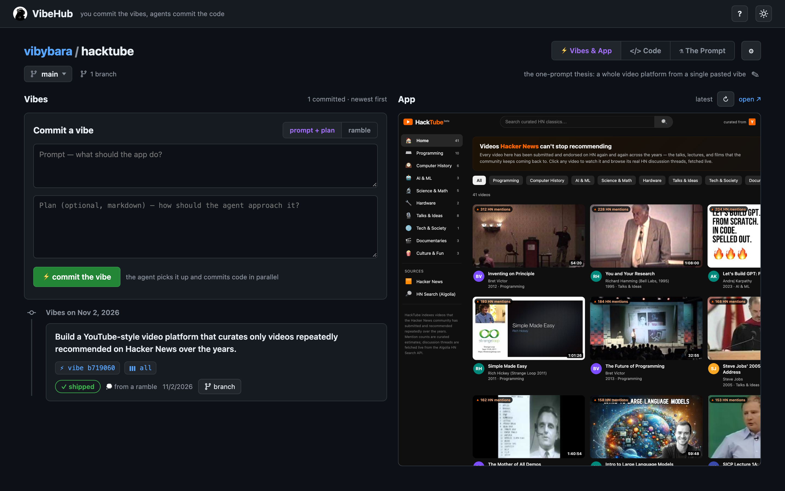
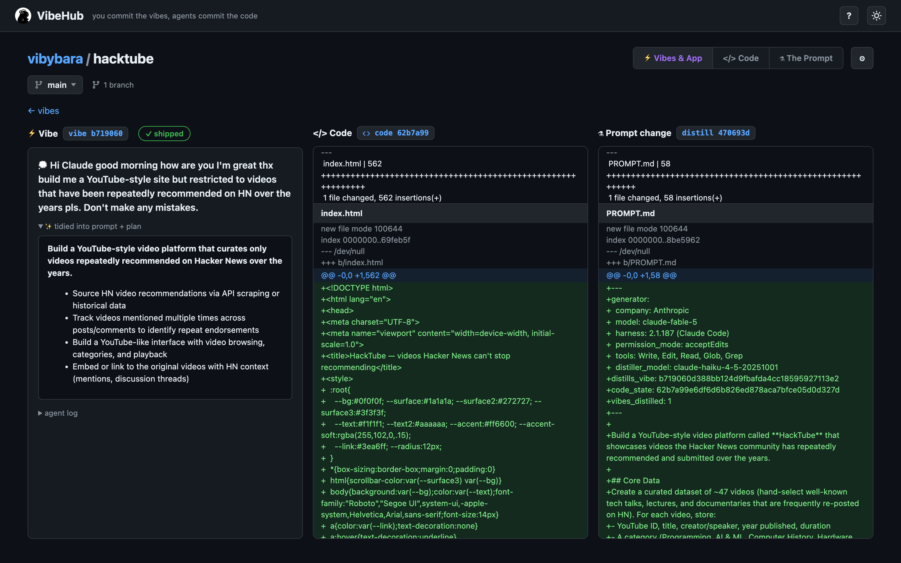

# ⚡ VibeHub

<p align="center">
  
</p>

> There's a new kind of coding I call "vibe coding", where you fully give in to the vibes, embrace exponentials, and forget that the code even exists…
>
> — Andrej Karpathy ([@karpathy](https://x.com/karpathy/status/1886192184808149383)), Feb 2 2025

More and more people are generating code rather than hand-coding it. This means code is accumulating faster than ever, but our validation and oversight processes are still catching up. One way to catch up is to extend the processes we know to work in software into the realm of agents.

For example, the field of software has standardized on saving and storing not just our code, but the entire history of code changes. This is called **version control**. Its purpose is partly to prevent the pain of data loss and partly to make it easier to collaborate with others. When it comes to agentic coding, we prompt or plan a project with an agent and the corresponding text we used for prompting or planning gets lost to archives, logs, compaction, or deletion. We used to do the same thing with code: If we wrote a new file to replace an old one, we would simply delete the old one. But we grew out of that habit.

Enter **VibeHub**: **_Version control_ for your _prompts_**.

Every time you prompt an agent to perform another code change for you, your prompt is stored in a commit and linked to the relevant code commit the agent made. This allows you to track how prompts changed the project over time as well as what code commit maps to each prompt. A comprehensive prompt to regenerate the app at that current commit is also generated.

Another way of viewing this: _What if we had GitHub for [natural language](https://x.com/karpathy/status/1617979122625712128)?_

NOTE: VibeHub is a proof-of-concept demo. Deployed sites are static, while the app can be run locally for actual version control utility.

## Features

### The Familiar

<p align="center">
  
</p>

The shapes you already know from git, GitHub, and live editors.

- **Profile & repos** — a GitHub-style single-user profile (editable, with an uploadable avatar), a filterable repo list with live app thumbnails, per-repo stats, and commit-activity sparklines; create, rename, and delete repos.
- **Two linked git histories** — a *vibes* history you author and a *code* history the agent authors, matched one-to-one so every change traces back to the prompt behind it.
- **Branching** — fork from the tip or any past vibe (pathy names like `feat/dark-mode` work); each branch gets its own histories, live preview, and time travel.
- **Live app viewer + time travel** — a running preview beside the timeline, no build step; click any vibe to see the app at that commit. The *all* view puts the vibe, its code diff, and the prompt change side by side.

### The Fresh

<p align="center">
  
  
</p>

What becomes possible once an agent does the building.

- **Living distilled prompt** — after each vibe, a read-only pass rewrites one self-contained prompt that would rebuild the app as it stands; its own **⚗ The Prompt** tab has the full history, a per-vibe diff, and hand-editing.
- **Ramble cleanup** — paste a stream-of-consciousness ramble and a small model turns it into a crisp prompt + plan before committing (the original ramble is kept).
- **Intent-replay merging** — not a textual git merge: an agent re-applies a branch's intent onto the base's code (reading the branch's finished code as reference), so there are no git conflicts.
- **⇄ Vibe Check** — a pull-request-style review: the distilled-prompt diff between branches, the two apps side by side, the vibes being merged, and the full code diff.

## Use

Clone:

```bash
$ git clone https://github.com/manunamz/vibehub
```

Run:

```bash
$ node server.js          # your instance, starts empty → localhost:3737
$ node server.js --demo   # or poke around the vibybara demo data
```

Needs Node ≥18 and `git`, with no dependencies.

### Agents

By default, VibeHub drives **Claude Code** (the `claude` CLI): each vibe runs `claude -p` headlessly and its log streams live as it works. The coding agent is file-only — `Write/Edit/Read/Glob/Grep`, no shell, web, or subagents. After each vibe, two read-only passes generate the distilled prompt and tidy rambles, on a small model (default `haiku`). You can set a different agent or model per repo in **⚙ settings**.

With no agent CLI installed, the agent step falls back to a **stub** — it doesn't build from your prompt, it just records each vibe to a placeholder `index.html` so the commit/history/preview flow still runs with zero setup. It's what the test suite uses, and it never touches an API.

## Deploy

A deployed VibeHub is a read-only static snapshot — no server, agents, or accounts. Write actions (new vibe, merge, edits) pop a modal pointing visitors to clone and run the real thing.

```bash
$ npm run build:site    # boots a demo server, snapshots it to ./dist
```

`build:site` runs the app in demo mode — seeding `data-demo/` from the committed `demo/` bundles — and exports every page: timelines, diffs, prompt history, branches with read-only Vibe Checks, and app previews at every commit. Point any static host at `dist/`.

## Config

| env var | default | meaning |
|---|---|---|
| `PORT` | `3737` | HTTP port |
| `VIBEHUB_DATA` | `./data` | where repos live |
| `VIBEHUB_USER` | `vibybara` | default profile name (editable in the UI) |
| `VIBEHUB_AGENT` | auto | global override: `claude` or `stub` (wins over repo settings) |
| `VIBEHUB_DISTILLER_MODEL` | `haiku` | default model for distill/ramble passes |
| `VIBEHUB_AGENT_TIMEOUT_MS` | `600000` | kill a stuck agent after this |
| `VIBEHUB_REPO_URL` | — | export-time: where the demo's "clone this" modal points |

## API

```
GET  /api/user                                   profile
POST /api/user                                   update profile
GET  /api/repos                                  list + stats (language, branches, activity…)
POST /api/repos                                  {name, description}
GET  /api/repos/:repo                            meta + vibes + code commits   (?branch=)
POST /api/repos/:repo/rename                     {name}
POST /api/repos/:repo/delete                     guarded while agents work
GET  /api/repos/:repo/settings                   agent kind/models + description
POST /api/repos/:repo/settings                   update settings
GET  /api/repos/:repo/branches                   list
POST /api/repos/:repo/branches                   {name, fromVibe?}
POST /api/repos/:repo/branches/:branch/delete    {force?} — warns on unmerged vibes
GET  /api/repos/:repo/compare?with=&base=        unmerged vibes + prompt/code diffs
POST /api/repos/:repo/merge                      {branch, base?} — intent-replay merge
POST /api/repos/:repo/vibes                      {prompt, plan} or {ramble} (+branch)
POST /api/repos/:repo/vibes/:sha/rerun           replay a failed vibe
GET  /api/repos/:repo/vibes/:sha/log             live agent log
GET  /api/repos/:repo/prompt                     current distillate              (?branch=)
POST /api/repos/:repo/prompt                     {body, branch?} — manual edit, commits
GET  /api/repos/:repo/prompt/history             one distill commit per vibe
GET  /api/repos/:repo/prompt/at/:sha             distillate at a version
GET  /api/repos/:repo/prompt/commits/:sha        prompt-change diff
GET  /api/repos/:repo/code/commits[/:sha]        history / one diff              (?branch=)
GET  /api/repos/:repo/code/tree?ref=             files at any ref
GET  /api/repos/:repo/code/blob?path=&ref=       file contents at any ref
GET  /preview/:repo/[~branch/][@sha/]            the app — live, per branch, or at any commit
```

## Data model

Each VibeHub repo holds **two parallel git histories**:

| history | author | contents |
|---|---|---|
| `vibes/` git repo | you | one markdown file per vibe (prompt + plan + original ramble), plus the distilled prompt |
| `code/` git repo | the agent | the actual app, one commit per vibe |

## Development

```sh
npm test            # unit + feature suites (node:test, zero deps, stub agents, ~1.5s)
```

Layout: `server.js` is HTTP glue; `lib/pipeline.js` is the domain layer (vibes, distillation, merges, recovery); `lib/store.js`, `lib/git.js`, and `lib/agent.js` are storage, git plumbing, and the agent adapter registry. The frontend is ordered classic scripts in `public/js/` sharing one top-level scope (load order defined in `index.html`) — no build step.
